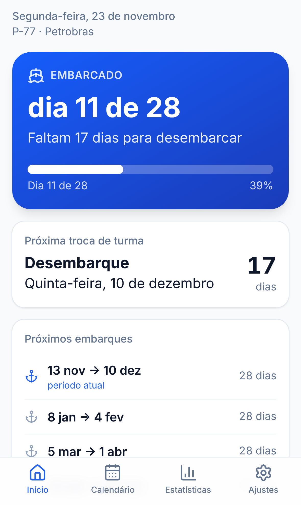
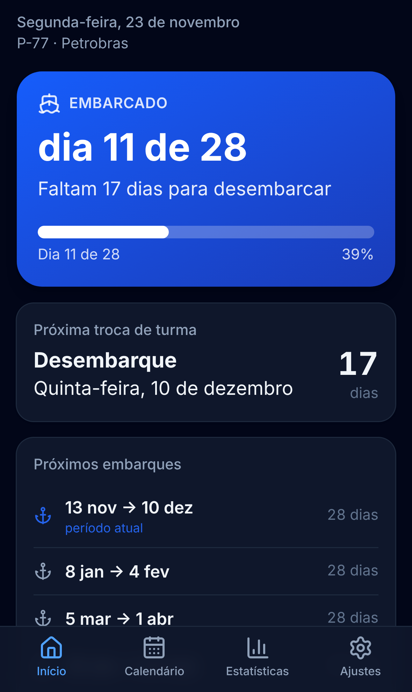

# Escala Embarque

App (PWA) para marítimos offshore acompanharem a escala de embarque (7x7, 14x14, 28x28, 28x14…).
Funciona sem internet, guarda os dados só no aparelho e é feito para ser instalado na tela inicial do iPhone.

<p align="center">
  
  
  
</p>

## O que já funciona

- Configuração inicial: regime (padrão ou personalizado), data de um embarque (âncora), regra do dia de desembarque, dias de viagem, embarcação e empresa
- **Início**: status grande (“EMBARCADO – dia 12 de 28” / “DE FOLGA – faltam 9 dias para embarcar”), barra de progresso, próxima troca de turma e próximos embarques
- **Calendário** mensal com cores (embarcado / folga / viagem), troca de turma marcada e detalhe do dia ao tocar
- **Meus eventos**: cadastre um compromisso (ex.: “ETAPA SP – 16/05/2027”) e o app responde na hora se você estará de folga, embarcado ou em dia de atenção (viagem, troca de turma, véspera de embarque). A resposta se atualiza sozinha se a escala mudar
- **Ajustes**: resumo e edição da escala, tema claro/escuro/sistema
- Funciona offline (service worker) e projeta a escala sem limite de anos

Próximas etapas: ajustes manuais (dobra, troca, curso, férias…) com prévia e re-ancoragem, feriados nacionais, estatísticas, histórico realizado, visão anual, exportação .ics / JSON / imagem.

## Rodar no computador

Requisitos: Node.js 22 ou mais novo.

```bash
npm install
npm run dev
```

Abra o endereço que aparecer (ex.: `http://localhost:5173/escala-embarque/`).

Outros comandos:

| Comando | O que faz |
| --- | --- |
| `npm test` | Roda os testes da lógica da escala |
| `npm run test:fusos` | Roda os testes em 4 fusos horários diferentes (São Paulo, UTC, +14h, Los Angeles) |
| `npm run typecheck` | Confere os tipos do TypeScript |
| `npm run build` | Gera a versão de produção em `dist/` |
| `npm run preview` | Serve a versão de produção localmente |

Para testar no iPhone pela rede de casa: `npm run dev -- --host` e abra no Safari o endereço `http://IP-DO-COMPUTADOR:5173/escala-embarque/`
(o modo offline só funciona de verdade na versão publicada, com HTTPS).

## Publicar no GitHub Pages

1. Crie um repositório no GitHub (de preferência chamado `escala-embarque`) e envie o código para a branch `main`.
2. No repositório, vá em **Settings → Pages** e em **Source** escolha **GitHub Actions**.
3. A cada push na `main`, o workflow `.github/workflows/deploy.yml` roda os testes, gera o build e publica.
4. O app fica em `https://SEU-USUARIO.github.io/NOME-DO-REPOSITORIO/`.

O caminho base é ajustado automaticamente pelo nome do repositório (variável `BASE_PATH` no workflow).

## Instalar no iPhone

1. Abra o endereço do app no **Safari** (precisa ser o Safari).
2. Toque no botão **Compartilhar** (quadrado com a seta para cima).
3. Role e toque em **Adicionar à Tela de Início**, depois em **Adicionar**.
4. Abra pelo ícone “Escala”. Depois da primeira abertura com internet, ele funciona offline a bordo.

Dica: os dados ficam guardados no próprio iPhone. Quando o backup estiver disponível, exporte de vez em quando.

## Como a escala é calculada

- Todas as datas são “puras” (`yyyy-MM-dd`, sem hora). As contas usam “número do dia”, então virada de ano, ano bissexto e fuso do aparelho não interferem. “Hoje” é sempre calculado no fuso `America/Sao_Paulo`.
- O ciclo sempre tem X + Y dias, partindo da **âncora** (uma data de embarque). Datas antes da âncora seguem o ciclo para trás.
- **Regra do desembarque**
  - *Conta como embarcado* (padrão): o desembarque é o último dia a bordo. Ex.: 14x14 embarcando em 02/03 → desembarque 15/03, folga de 16/03 a 29/03, próximo embarque 30/03.
  - *Conta como folga*: o desembarque é no dia seguinte (16/03) e já é o 1º dia de folga. O próximo embarque continua 30/03.
- **Dias de viagem** ocupam dias da folga (antes do embarque / depois do desembarque) e aparecem em laranja; contam como folga.

## Estrutura

```
src/
  dominio/      lógica pura da escala (datas, ciclo, status) + testes
  dados/        banco local (IndexedDB via Dexie) e hooks
  telas/        Início, Calendário, Estatísticas, Ajustes, configuração
  componentes/  barra de abas, painel inferior, cartões, cores
```

## Referências

A interface se inspirou em [Shifter](https://github.com/schmehla/shifter) (sem licença, então nenhum código foi copiado) e em [ShiftCalendar](https://github.com/iTroy0/ShiftCalendar) (MIT; também só inspiração, nenhum trecho reaproveitado).
