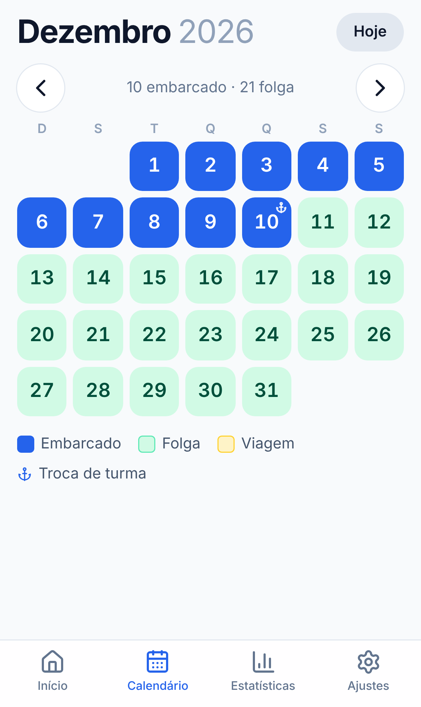

# Escala Embarque

App (PWA) para marítimos offshore acompanharem a escala de embarque (7x7, 14x14, 28x28, 28x14…).
Funciona sem internet, guarda os dados só no aparelho e é feito para ser instalado na tela inicial do iPhone.

<p align="center">
  
  
  
</p>

## O que já funciona

- Configuração inicial: regime (padrão ou personalizado), data de um embarque (âncora), regra do dia de desembarque, dias de viagem, embarcação e empresa
- **Início**: status grande (“EMBARCADO – dia 12 de 28” / “DE FOLGA – faltam 9 dias para embarcar”), barra de progresso, próxima troca de turma e próximos embarques
- **Calendário** com visão de mês e de ano (12 meses numa tela; toque no mês para abrir), cores (embarcado / folga / viagem), troca de turma marcada e detalhe do dia ao tocar
- **Meus eventos**: cadastre um compromisso (ex.: “ETAPA SP – 16/05/2027”) e o app responde na hora se você estará de folga, embarcado ou em dia de atenção (viagem, troca de turma, véspera de embarque). A resposta se atualiza sozinha se a escala mudar
- **Ajustes de escala**: dobra, antecipação, atraso, troca com colega, curso, afastamento e férias, cada um com datas e observação. Depois do ajuste você escolhe voltar ao ciclo original ou re-ancorar a escala, e vê uma prévia (próximos embarques antes → depois e os dias que mudam) antes de confirmar. Crie pelo calendário (toque no dia) ou em Configurações
- **Estatísticas** por ano: dias a bordo e em terra, distribuição (embarcado, folga, viagem, curso, férias, afastamento), já passou × ainda vem, dias a bordo por mês, ajustes do ano (dobras e dias extras), embarques e maior período a bordo
- **Exportar para a agenda (.ics)**: períodos a bordo (e, se quiser, as folgas), cursos, férias e afastamentos dos próximos 12 meses ou 3 anos, para importar no Calendário do iPhone ou no Google Agenda
- **Backup**: salvar (folha de compartilhar no iPhone / download no computador) ou copiar como texto; restaurar por arquivo ou texto colado, com validação e resumo antes de substituir. A primeira tela também oferece restaurar um backup (troca de celular)
- **Histórico**: os dias que já passaram ficam gravados separados da projeção. Mudar a escala vale de hoje em diante; corrigir o passado é feito com ajustes naqueles dias, que atualizam o histórico
- **Configurações**: resumo e edição da escala, lista de ajustes, histórico, tema claro/escuro/sistema
- Funciona offline (service worker) e projeta a escala sem limite de anos

Próximas etapas: imagem do mês/ano para o WhatsApp.

## Rodar no computador

Requisitos: Node.js 22 ou mais novo.

```bash
npm install
npm run dev
```

Abra o endereço que aparecer (ex.: `http://localhost:5173/escala-embarque/`).

Outros comandos:

| Comando | O que faz |
| --- | --- |
| `npm test` | Roda os testes da lógica da escala |
| `npm run test:fusos` | Roda os testes em 4 fusos horários diferentes (São Paulo, UTC, +14h, Los Angeles) |
| `npm run typecheck` | Confere os tipos do TypeScript |
| `npm run build` | Gera a versão de produção em `dist/` |
| `npm run preview` | Serve a versão de produção localmente |

Para testar no iPhone pela rede de casa: `npm run dev -- --host` e abra no Safari o endereço `http://IP-DO-COMPUTADOR:5173/escala-embarque/`
(o modo offline só funciona de verdade na versão publicada, com HTTPS).

## Publicar no GitHub Pages

1. Crie um repositório no GitHub (de preferência chamado `escala-embarque`) e envie o código para a branch `main`.
2. No repositório, vá em **Settings → Pages** e em **Source** escolha **GitHub Actions**.
3. A cada push na `main`, o workflow `.github/workflows/deploy.yml` roda os testes, gera o build e publica.
4. O app fica em `https://SEU-USUARIO.github.io/NOME-DO-REPOSITORIO/`.

O caminho base é ajustado automaticamente pelo nome do repositório (variável `BASE_PATH` no workflow).

## Instalar no iPhone

1. Abra o endereço do app no **Safari** (precisa ser o Safari).
2. Toque no botão **Compartilhar** (quadrado com a seta para cima).
3. Role e toque em **Adicionar à Tela de Início**, depois em **Adicionar**.
4. Abra pelo ícone “Escala”. Depois da primeira abertura com internet, ele funciona offline a bordo.

Dica: os dados ficam guardados no próprio iPhone. Quando o backup estiver disponível, exporte de vez em quando.

## Como a escala é calculada

- Todas as datas são “puras” (`yyyy-MM-dd`, sem hora). As contas usam “número do dia”, então virada de ano, ano bissexto e fuso do aparelho não interferem. “Hoje” é sempre calculado no fuso `America/Sao_Paulo`.
- O ciclo sempre tem X + Y dias, partindo da **âncora** (uma data de embarque). Datas antes da âncora seguem o ciclo para trás.
- **Em que dia você desembarca** (regra do desembarque)
  - *No último dia a bordo* (padrão, ex.: 28º dia no 28x28): o desembarque conta como dia embarcado. Ex.: 14x14 embarcando em 02/03 → desembarque 15/03, folga de 16/03 a 29/03, próximo embarque 30/03.
  - *No dia seguinte, o dia da troca* (ex.: 29º dia no 28x28): o desembarque (16/03 no exemplo) já é o 1º dia de folga e, com 1 dia de viagem depois, aparece como viagem. O próximo embarque continua 30/03.
- **Ajustes** valem por cima do ciclo. Embarque, desembarque e dias de viagem são recalculados a partir dos dias a bordo, então numa dobra o desembarque e a viagem andam junto. Se dois ajustes caem no mesmo dia, vale o mais recente.
  - *Voltar ao ciclo original*: só os dias do ajuste mudam.
  - *Re-ancorar*: a escala recomeça do fim do ajuste. Dobra/troca embarcado: o último dia do ajuste vira o último dia a bordo e vem a folga completa. Antecipação: os X dias a bordo contam do novo embarque. Atraso, curso, afastamento, férias, troca de folga: embarca no dia seguinte ao fim.
- **Histórico (escala realizada)**: toda vez que o app abre, grava os dias até ontem numa tabela separada (`realizados`), começando em 1º de janeiro do ano em que o app foi configurado. O calendário mostra o passado pelo histórico e o futuro pela projeção.
  - Editar a escala não muda o passado.
  - Um ajuste que mexe no passado regrava só os dias que ele muda; embarque, desembarque, viagem e "dia X de Y" são recalculados em volta.
  - Em Config. há a opção de refazer o histórico pela escala atual (para quando a configuração inicial estava errada).
- **Dias de viagem** ocupam dias da folga (antes do embarque / depois do desembarque) e aparecem em laranja; contam como folga.

## Estrutura

```
src/
  dominio/      lógica pura da escala (datas, ciclo, status) + testes
  dados/        banco local (IndexedDB via Dexie) e hooks
  telas/        Início, Calendário, Estatísticas, Ajustes, configuração
  componentes/  barra de abas, painel inferior, cartões, cores
```

## Referências

A interface se inspirou em [Shifter](https://github.com/schmehla/shifter) (sem licença, então nenhum código foi copiado) e em [ShiftCalendar](https://github.com/iTroy0/ShiftCalendar) (MIT; também só inspiração, nenhum trecho reaproveitado).
